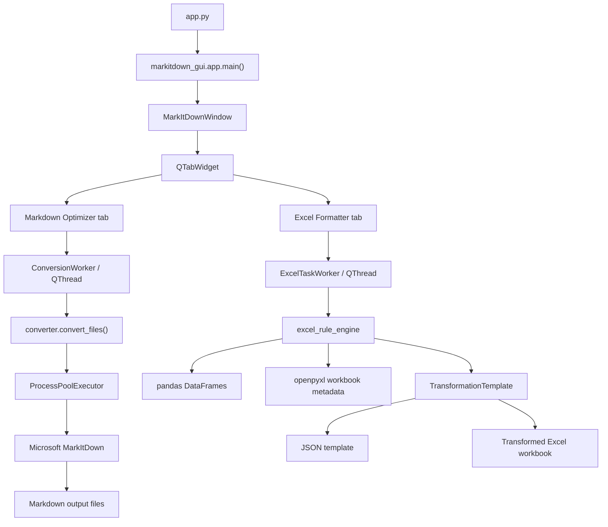
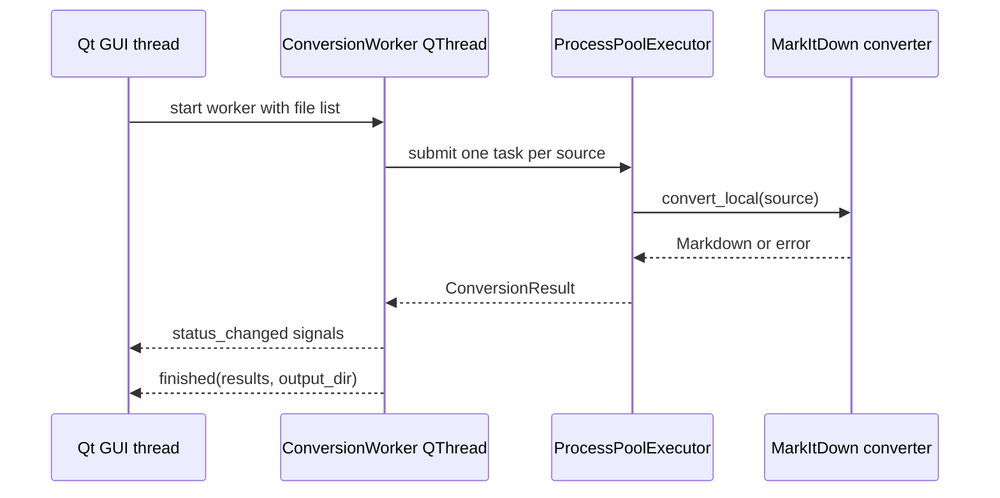
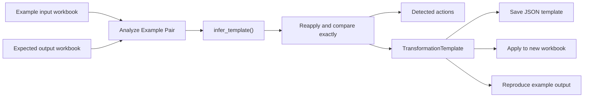

# File Optimizer for AI: Technical Documentation

This document describes the internal architecture, data flow, algorithms,
threading model, packaging process, tests, and extension points of File
Optimizer for AI.

It is intended for maintainers and contributors who need to understand how the
application works beyond the user-level instructions in `README.md`.

## 1. System Overview

File Optimizer for AI is a Windows-oriented Python desktop application built
with PySide6. It currently contains two independent workflows inside one
tabbed interface:

1. **Markdown Optimizer**
   - Converts supported local files to Markdown with Microsoft MarkItDown.
   - Supports batch conversion and multiprocessing.
   - Estimates source and Markdown token counts.

2. **Excel Formatter**
   - Learns deterministic transformations from an example input workbook and
     its expected output.
   - Verifies that inferred rules reproduce the example exactly.
   - Saves reusable rules as JSON templates.
   - Applies templates to compatible workbooks without using an LLM.

Both workflows run expensive work outside the Qt GUI thread.



## 2. Repository Structure

```text
.
|-- app.py
|-- markitdown_gui/
|   |-- __init__.py
|   |-- app.py
|   |-- converter.py
|   `-- excel_rule_engine.py
|-- tests/
|   |-- test_converter.py
|   `-- test_excel_rule_engine.py
|-- assets/
|   `-- app.ico
|-- scripts/
|   |-- build_windows_installer.ps1
|   `-- create_icon.py
|-- packaging/
|   |-- FileOptimizerForAI.spec
|   |-- FileOptimizerForAI.iss
|   `-- license.txt
|-- requirements.txt
|-- requirements-build.txt
|-- install.bat
|-- run.bat
|-- README.md
`-- docs/
    `-- TECHNICAL.md
```

Generated folders such as `build`, `dist`, and `installer` are release
artifacts rather than application source.

## 3. Runtime Dependencies

### Application dependencies

| Dependency | Purpose |
| --- | --- |
| PySide6 | Desktop GUI, widgets, signals, and worker threads |
| MarkItDown | Conversion of supported files to Markdown |
| pandas | Tabular comparison and transformation inference |
| openpyxl | Excel reading, formulas, styles, and workbook writing |

`markitdown[all]` installs converters and their optional Python dependencies
for the supported MarkItDown formats.

### Build dependency

| Dependency | Purpose |
| --- | --- |
| PyInstaller | Creates the standalone Windows application directory |
| Inno Setup | Creates the Windows setup executable |

## 4. Application Entry Points

### `app.py`

The root `app.py` is the executable entry point for source and packaged runs.

Normal execution calls:

```python
from markitdown_gui.app import main

main()
```

It also exposes a `--convert-smoke` path used to perform command-line
conversion checks without starting the GUI:

```text
File Optimizer for AI.exe --convert-smoke OUTPUT SOURCE...
```

The process exits with code `0` only when every source converts successfully.

### `markitdown_gui.app.main()`

The GUI entry point:

1. Calls `freeze_support()` for packaged multiprocessing compatibility.
2. Creates the `QApplication`.
3. Applies the global Qt stylesheet.
4. Resolves and applies the packaged application icon.
5. Creates and shows `MarkItDownWindow`.
6. Enters the Qt event loop.

`freeze_support()` is required because Markdown batch conversion can create
worker processes on Windows. Without it, a frozen executable can recursively
start application windows or fail to initialize child processes.

## 5. User Interface Architecture

### Main window

`MarkItDownWindow` is the top-level `QMainWindow`. It owns:

- The shared outer shell
- The tab widget
- The Markdown Optimizer controls and state
- The Markdown conversion worker lifecycle
- Drag-and-drop handling for Markdown sources

The two tabs are:

- `Markdown Optimizer`
- `Excel Formatter`

The Excel tab is implemented as a separate `ExcelFormatterTab` widget to keep
its state and worker lifecycle isolated from the Markdown workflow.

### Ant-inspired design system

The interface uses a single Qt stylesheet named `APP_STYLE`. Its visual system
is based on:

- Primary blue: `#1677ff`
- Darker interaction blue: `#0958d9`
- Pale blue surfaces: `#eff6ff`, `#f0f7ff`, and `#e6f4ff`
- White cards with light blue borders
- Rounded cards, inputs, tables, and buttons
- Segoe UI-compatible body typography
- Georgia headings
- Underlined active tabs

The stylesheet covers:

- Shell and card surfaces
- Hero sections
- Drop-zone states
- Buttons and primary buttons
- Inputs and text editors
- Tables and headers
- Progress indicators
- Tab selection and hover states

### Programmatic icons

`line_icon()` draws lightweight icons into a transparent `QPixmap` with
`QPainter`. This avoids requiring a separate asset for every toolbar action.

Supported icon names currently include:

- `file`
- `folder`
- `remove`
- `reset`
- `info`
- `check`
- `open`

### Startup animation

`_animate_window_in()` adds a `QGraphicsOpacityEffect` to the shared shell and
animates opacity from `0` to `1` over 320 milliseconds.

Metric labels deliberately do not use nested opacity effects. Nested Qt
graphics effects previously caused queued-file and token-reduction values to
become invisible on some Windows systems.

## 6. Markdown Optimizer

### Supported input selection

The GUI accepts extensions listed in `SUPPORTED_EXTENSIONS`, including:

- PDF and Office documents
- Excel and CSV
- HTML, XML, JSON, and text
- Common image and audio formats
- EPUB and ZIP

Selecting files does not immediately convert them. `_queue_files()`:

1. Resolves each path to an absolute path.
2. Verifies that it is a file.
3. Ignores duplicate paths.
4. Appends it to `self.files`.
5. Creates a table row with a `Ready` status.
6. Rebuilds the path-to-row map.
7. Updates the metric cards.

### Folder selection

`_add_folder()` scans only the selected folder's immediate children. It does
not recursively traverse subdirectories.

Only files whose suffix appears in `SUPPORTED_EXTENSIONS` are added.

### Drag and drop

`MarkItDownWindow` accepts URL-based Qt drag events.

- Files are queued directly.
- Dropped folders contribute supported immediate child files.
- The drop-zone `dragging` property changes the visual state.

### Output location

`default_output_dir()` chooses:

```text
%USERPROFILE%\Documents\File Optimizer for AI\Markdown
```

If the Documents folder cannot be found, it falls back to the user's home
directory.

This avoids writing into the installation directory when the application is
installed under `Program Files`.

Before conversion, `_prepare_output_dir()`:

1. Creates the directory if necessary.
2. Creates a small probe file.
3. Deletes the probe file.
4. Proceeds only if the complete write test succeeds.

Windows access-denied errors display a targeted message explaining how to run
the application as administrator or choose a user-writable folder.

### Conversion data model

Each conversion produces a `ConversionResult`:

| Field | Meaning |
| --- | --- |
| `source` | Original input path |
| `output` | Markdown output path, or `None` on failure |
| `error` | Error message, or `None` on success |
| `source_tokens_estimate` | Approximate source token count |
| `markdown_tokens_estimate` | Approximate Markdown token count |
| `tokens_saved_estimate` | Non-negative estimated reduction |
| `token_savings_percent` | Estimated percentage reduction |

The `succeeded` property returns `True` when `error` is `None`.

### Output collision handling

`unique_output_path()` never overwrites an existing Markdown file.

For a source named `report.pdf`, it attempts:

```text
report.md
report_2.md
report_3.md
...
```

`plan_outputs()` also reserves paths across the current batch, preventing two
source files with the same stem from selecting the same destination.

### MarkItDown conversion

`_convert_one_file()` performs one conversion:

1. Imports `MarkItDown`.
2. Creates `MarkItDown(enable_plugins=False)`.
3. Calls `convert_local()` with the source path.
4. Reads `text_content`, falling back to `markdown` for API compatibility.
5. Writes UTF-8 Markdown.
6. Calculates token estimates.
7. Returns a success or failure `ConversionResult`.

The application intentionally uses `convert_local()` instead of the broader
`convert()` API because the GUI operates on local files.

Third-party MarkItDown plugins are disabled.

### Token estimation

`estimate_tokens()` uses the common rough estimate:

```text
estimated tokens = round(character or byte count / 4)
```

For source files, the estimator uses file size in bytes. For Markdown, it uses
the generated text length.

This is useful for relative feedback but is not model-specific. It does not
run an OpenAI, Anthropic, Google, or other tokenizer.

### Concurrency model

Markdown conversion uses two concurrency layers:



The Qt worker thread keeps orchestration away from the event loop.

`ProcessPoolExecutor` lets independent conversions use multiple CPU cores. The
worker count is limited to the smaller of:

- The number of files
- The detected CPU count

If only one worker is required, conversion runs sequentially without creating
a process pool.

### Conversion completion

`_finish_conversion()`:

1. Re-enables the controls.
2. Counts successful and failed files.
3. Aggregates source and Markdown token estimates.
4. Updates the metric cards.
5. Displays failure details when needed.
6. Offers to open the output folder after complete success.

Failures are isolated per file where possible. One unreadable source does not
stop the remaining batch.

## 7. Excel Formatter

### Design goal

The Excel Formatter is a deterministic example-based transformation engine.
It does not ask an LLM to interpret the workbooks.

Given:

- An example input workbook
- The expected output workbook

it searches for a supported rule set, applies that rule set to the input, and
accepts it only when the reproduced DataFrame matches the expected output.

This conservative validation is the central safety property of the formatter.

### Supported workbook formats

The engine accepts:

- `.xlsx`
- `.xlsm`

The output dialog currently writes `.xlsx`.

### Excel tab workflow



### UI class

`ExcelFormatterTab` owns:

- Example input path
- Expected output path
- Current `TransformationTemplate`
- Detected-actions text
- Save/load/apply/export controls
- A dedicated `QThread`
- An `ExcelTaskWorker`

Analysis and application are performed outside the GUI thread.

### Background task abstraction

`ExcelTaskWorker` accepts:

- A callable
- Positional arguments

It invokes the callable with an added `progress` callback and emits:

- `status_changed`
- `finished`
- `failed`

This allows both `infer_template()` and `apply_template()` to share the same
threading infrastructure.

### Core rule data model

#### `ColumnRule`

Maps an input column to an output column:

```json
{
  "source": "Score",
  "output": "Marks"
}
```

#### `AggregateRule`

Defines a grouped aggregation:

```json
{
  "source": "Sales",
  "output": "Total Sales",
  "function": "sum"
}
```

Supported aggregation names are:

- `sum`
- `mean`
- `min`
- `max`
- `count`
- `median`
- `first`
- `last`

#### `SortRule`

Defines an output sort column and direction:

```json
{
  "column": "Total Sales",
  "ascending": false
}
```

#### `FilterRule`

Defines one inferred comparison:

```json
{
  "source": "Date",
  "operator": ">=",
  "value": "2019-01-01T00:00:00",
  "value_type": "datetime"
}
```

#### `FormulaRule`

Defines a binary arithmetic expression:

```json
{
  "output": "Total",
  "operator": "*",
  "left_kind": "column",
  "left_value": "Quantity",
  "right_kind": "column",
  "right_value": "Unit Price"
}
```

Operands can be:

- A source column
- A numeric constant

Supported operators are:

- Addition
- Subtraction
- Multiplication
- Division

#### `SheetRule`

A sheet rule contains:

- Expected input and output sheet names
- Operation type: `project` or `group`
- Direct column mappings
- Grouping columns
- Aggregations
- Arithmetic formulas
- Filters
- Sort rules
- Final output column order
- Captured workbook style metadata

#### `TransformationTemplate`

A template contains:

- Template schema version
- One or more `SheetRule` objects
- Human-readable action descriptions

Only version `1` is currently supported.

### Workbook reading

`read_workbook()` opens each workbook twice:

1. `data_only=False` to inspect formulas.
2. `data_only=True` to read cached formula values when available.

For each worksheet:

1. The first row is treated as headers.
2. Columns without headers are ignored.
3. Empty rows and columns are removed.
4. Header text is stripped.
5. Duplicate headers are rejected.
6. The result becomes a pandas DataFrame.

### Formula fallback during reading

Excel files created by libraries may contain formulas without cached results.
The engine can locally evaluate a narrow formula grammar:

```text
operand operator operand
```

An operand can be:

- A same-row cell reference
- A numeric constant

The evaluator also unwraps the format:

```excel
=IFERROR(B2*C2,"")
```

This fallback supports arithmetic only. Unsupported formulas remain as formula
strings and will normally prevent unsafe inference.

### Value normalization

Comparisons normalize values to reduce irrelevant type differences:

- Missing values become `None`.
- pandas timestamps become ISO strings where signatures are needed.
- Date-like values use `isoformat()` when available.
- Numbers are rounded to ten decimal places for signatures.
- DataFrame equality ignores dtype differences but retains column names and
  order.

### Direct projection inference

`infer_direct_rule()` searches for transformations based on row-level data:

1. For each expected output column, find input columns whose values can contain
   the expected output values.
2. Prefer normalized header-name matches.
3. Use header similarity only when one candidate is clearly stronger.
4. Mark remaining output columns as possible formulas.
5. Build the projected DataFrame.
6. Infer sorting.
7. If rows were removed, attempt a single filter.
8. Accept only if the final candidate matches the expected DataFrame.

This can infer:

- Column selection
- Column removal
- Column renaming
- Column reordering
- Arithmetic calculated columns
- One simple filter
- Sorting

### Formula inference

`infer_formula_rule()` first identifies numeric input columns and requires the
expected output column to be numeric.

It tests:

1. Ordered pairs of numeric columns.
2. Each supported arithmetic operator.
3. Column-and-constant combinations.
4. Constant-and-column combinations.

A candidate formula is retained only when its values match the expected output
as a multiset after numeric normalization.

Ambiguous formula candidates are not accepted unless the inference logic can
select one safely.

### Filter inference

The engine supports a conservative single-filter search.

It tests candidate comparisons that can explain why the expected output has
fewer rows than the example input, then reruns projection, formulas, and sort
validation.

Filter values are serialized with explicit value types so dates and other
values can be reconstructed when applying a saved template.

Complex compound conditions are intentionally unsupported.

### Sort inference

`infer_sort()` tries stable sorting by:

- One column
- Two columns
- Three columns

For every selected key set, it tests ascending and descending directions.

`mergesort` is used to keep ordering stable. A sort is accepted only when it
reproduces the expected frame.

### Grouped inference

`infer_group_rule()` searches for grouped transformations:

1. Generate plausible grouping-key mappings.
2. Identify expected columns that could be aggregations.
3. Test supported aggregation functions.
4. Construct grouped candidate DataFrames.
5. Infer formulas calculated after grouping.
6. Infer final sorting.
7. Verify the complete result.

This supports workflows such as:

```text
Group by Student ID
Sum Marks as Total Marks
Sum Possible Marks as Total Possible
Calculate Percentage = Total Marks / Total Possible
Sort by Percentage descending
```

### Sheet matching

During example analysis, output sheets are matched against unused input sheets.

Preference is given to:

1. Identical sheet names
2. Similar sheet names
3. Sheets whose data can reproduce the expected output

During template application, `schema_match_score()` checks whether a candidate
sheet contains every column required by a rule. Exact original sheet names are
preferred, but renamed sheets can be used when their schemas match.

Each input sheet is used at most once per application.

### Exact verification

After a sheet rule is inferred, the engine immediately applies it to the
example input:

```python
reproduced = apply_sheet_rule(input_frame, rule)
```

It then compares `reproduced` with the expected output.

If they do not match, the template is rejected with `InferenceError`.

This verification prevents a plausible-looking but incorrect rule from being
saved.

### Styling capture

`extract_style()` reads selected properties from the expected output:

- Header font name
- Header font size
- Bold and italic state
- Header font color
- Header fill color
- Horizontal and vertical alignment
- Column widths
- Number formats
- Freeze panes
- Auto-filter presence

The style model is intentionally narrow. It does not attempt to clone every
cell style, chart, image, conditional format, macro, or workbook object.

### Template serialization

`save_template()` serializes the complete dataclass structure as indented JSON.

`load_template()`:

1. Reads JSON.
2. Checks `version`.
3. Reconstructs nested rule dataclasses.
4. Rejects unsupported versions.

This gives templates a stable, inspectable format that can be versioned and
shared.

### Applying a template

`apply_template()`:

1. Validates the new input workbook.
2. Prevents overwriting the input path.
3. Reads every tabular input sheet.
4. Matches each template rule to a compatible unused sheet.
5. Applies successful rules.
6. Records warnings for missing, substituted, skipped, and ignored sheets.
7. Writes generated DataFrames with pandas and openpyxl.
8. Reopens the workbook.
9. Applies captured styles.
10. Writes Excel formulas where references can be preserved.
11. Saves and closes the workbook.

If some rules succeed and others fail, the application writes the successful
results and adds a `Transformation Warnings` worksheet.

If no rule can be applied, no transformed workbook is produced.

### Formula export

When all required source columns remain available in the output,
`write_excel_formulas()` writes real Excel formulas such as:

```excel
=IFERROR(B2*C2,"")
```

If source-to-output references cannot be mapped safely, the already calculated
value remains in the exported DataFrame instead.

### Output sheet names

Excel limits sheet names to 31 characters.

`unique_sheet_name()`:

- Truncates long names.
- Prevents duplicate sheet names.
- Adds suffixes such as ` (2)` when necessary.

## 8. Error Handling

### Markdown errors

Expected error categories include:

- Missing MarkItDown installation
- Unsupported or damaged source files
- Converter-specific failures
- Output permission errors

Per-file errors are stored in `ConversionResult`. Fatal startup or orchestration
errors are emitted through `ConversionWorker.failed`.

### Excel errors

Expected error categories include:

- Missing workbooks
- Unsupported workbook extensions
- No tabular worksheets
- Duplicate headers
- Ambiguous transformations
- Unsupported formulas or operations
- Missing required columns
- Attempting to overwrite the input workbook

Inference failures use `InferenceError` when the example cannot be represented
safely.

### GUI thread safety

Workers do not directly mutate widgets.

They communicate with the GUI through Qt signals, and connected slots run on
the receiving object's thread.

## 9. Security and Privacy

### Local-file scope

The Markdown workflow calls `convert_local()` and disables MarkItDown plugins.

The Excel workflow uses local pandas and openpyxl processing.

The application itself does not contain API keys, LLM clients, telemetry, user
accounts, or a server component.

### Process privileges

Every operation runs with the current Windows process privileges. Running as
administrator expands the locations and files the process can access.

Administrator execution should therefore be used only when a protected output
location is required.

### Untrusted files

The application parses complex document formats through third-party libraries.
Users should avoid processing untrusted files, and maintainers should keep
dependencies patched.

Excel formulas are written as formulas but are not executed by the
application. Excel may evaluate them when the output workbook is opened.

## 10. Source Installation

`install.bat`:

1. Searches for Python 3.13.
2. Falls back to the Python launcher or a supported `python` command.
3. Rejects unsupported Python versions.
4. Creates `.tkvenv`.
5. Upgrades pip.
6. Installs `requirements.txt`.
7. Verifies imports for PySide6 and MarkItDown.

`run.bat` verifies the environment and runs:

```text
.tkvenv\Scripts\pythonw.exe app.py
```

`pythonw.exe` avoids opening a console window with the desktop application.

## 11. Packaging

### PyInstaller

`packaging/FileOptimizerForAI.spec`:

- Uses `app.py` as the entry point.
- Includes `assets/app.ico`.
- Collects package data, binaries, hidden imports, and metadata.
- Bundles MarkItDown and its converters.
- Bundles pandas and openpyxl.
- Builds a windowed executable with no console.
- Produces an onedir application under `dist`.

The package collection list is explicit because document-conversion libraries
often use dynamic imports that static analysis cannot discover reliably.

### Inno Setup

`packaging/FileOptimizerForAI.iss`:

- Installs into `Program Files` by default.
- Creates Start Menu shortcuts.
- Offers an optional desktop shortcut.
- Registers an uninstaller.
- Can launch the app after setup.
- Allows the Windows privilege dialog override.

The installer currently uses application version `1.0.0`.

### Build script

`scripts/build_windows_installer.ps1`:

1. Verifies `.tkvenv`.
2. Installs build dependencies.
3. Generates the icon.
4. runs PyInstaller.
5. Locates Inno Setup.
6. compiles the installer.

Build output locations:

```text
dist\File Optimizer for AI\
installer\FileOptimizerForAI-Setup-1.0.0.exe
```

Installer generation is a release operation and is not required for normal
development or testing.

## 12. Automated Tests

Run all tests with:

```powershell
python -m unittest discover -s tests
```

### Markdown tests

`tests/test_converter.py` covers:

- Markdown extension selection
- Existing-output collision handling
- Duplicate source stems
- Token estimation
- Worker count selection
- Isolation of a failed file from the rest of a batch

The conversion test injects a fake `markitdown` module so it can verify
orchestration without invoking the real converter.

### Excel tests

`tests/test_excel_rule_engine.py` covers:

- Projection, renaming, removal, and sorting
- Grouping, aggregation, and style reuse
- Date filtering
- Column arithmetic
- Real Excel formula export
- Uncached formula reading
- Constant arithmetic formulas
- Formulas after grouping
- Conservative rejection of unsupported calculations
- Renamed worksheet matching
- Partial multi-sheet output with warnings

The tests build temporary workbooks and inspect exported files with pandas and
openpyxl.

### GUI verification

There is currently no committed automated Qt widget test suite.

During development, the UI can be initialized without a display by setting:

```powershell
$env:QT_QPA_PLATFORM = "offscreen"
```

This is useful for:

- Checking that the window can be constructed
- Verifying the tab count and labels
- Inspecting control state
- Rendering screenshots in CI-like environments

## 13. Current Limitations

### Markdown Optimizer

- Token counts are estimates.
- Folder scanning is not recursive.
- Conversion quality depends on MarkItDown and source structure.
- Some formats require external software or services.
- There is no cancellation control for a running conversion.
- There is no persistent conversion history.

### Excel Formatter

- Only `.xlsx` and `.xlsm` inputs are accepted.
- Output is written as `.xlsx`.
- Macros are not preserved in exported files.
- Only deterministic supported transformations are inferred.
- Compound filters are unsupported.
- Cross-workbook and cross-sheet joins are unsupported.
- Pivot tables are unsupported.
- Lookup, text, date, conditional, and nonlinear formulas are not generally
  inferred.
- Complex workbook objects and cell-by-cell formatting are not reproduced.
- Formulas are limited to binary arithmetic.
- The inference search can become expensive on very wide workbooks.

## 14. Extension Guide

### Adding another top-level tool

Prefer a separate QWidget tab:

1. Create a class such as `DataProfilerTab`.
2. Keep its state inside the tab class.
3. Use a worker object and `QThread` for expensive work.
4. Add the tab in `MarkItDownWindow._build_ui()`.
5. Reuse `APP_STYLE` object names and standard buttons.
6. Add focused engine tests separately from UI tests.

### Adding a Markdown input format

If MarkItDown supports the format:

1. Add the extension to `SUPPORTED_EXTENSIONS`.
2. Confirm the packaged dependency is collected.
3. Add a conversion smoke test.
4. Update both README files.

### Adding an Excel aggregation

1. Add its name to `AGGREGATIONS`.
2. Implement it in `aggregate_series()`.
3. Ensure inference can distinguish it from existing functions.
4. Add positive and ambiguous-case tests.
5. Verify JSON templates remain backward compatible.

### Adding an Excel formula operator

1. Extend `FORMULA_OPERATORS`.
2. Update `evaluate_simple_excel_formula()`.
3. Update `evaluate_formula()`.
4. Confirm Excel formula export syntax.
5. Add inference, application, and export tests.

### Evolving the template format

Do not silently change version `1`.

A schema change should:

1. Increment the template version.
2. Add explicit parsing for the new version.
3. Decide whether older templates can be migrated.
4. Keep clear errors for unsupported versions.
5. Add round-trip and compatibility tests.

### Adding cancellation

Qt thread interruption alone cannot safely stop a running process-pool task.
A complete implementation would need:

- A shared cancellation signal
- Checks between submitted and completed jobs
- Process-pool shutdown behavior
- UI state for cancelling and cleanup
- Tests for partial outputs

### Adding data-analysis tools

Recommended future modules include:

- Data profiling
- Data cleaning
- Chart creation
- Statistical tests
- Pivot-table building
- Dataset merging and reshaping
- Reproducible report generation
- Workflow history and pandas-code export

Each should keep computation separate from Qt widgets and expose a testable
engine API.

## 15. Maintenance Checklist

Before merging a change:

1. Run the complete unit test suite.
2. Run `py_compile` on modified Python modules.
3. Start the Qt application offscreen or interactively.
4. Verify both tabs still initialize.
5. Test permission errors with a protected output path when relevant.
6. Confirm existing user files are never overwritten unexpectedly.
7. Run `git diff --check`.
8. Update public and technical documentation when behavior changes.

Before creating a release:

1. Update the application version consistently.
2. Rebuild from a clean environment.
3. Run conversion smoke tests against the packaged executable.
4. Test Excel analysis and template application in the packaged app.
5. Install with Inno Setup as a standard user.
6. Verify Program Files behavior.
7. Test uninstall behavior.
8. Publish checksums with the release installer.

## 16. Architectural Principles

The application follows several practical principles:

- **Local-first:** core workflows operate on local files.
- **Conservative inference:** Excel rules are accepted only after verification.
- **Responsive UI:** expensive work runs outside the GUI thread.
- **No silent overwrite:** Markdown outputs receive unique names, and Excel
  input/output path equality is rejected.
- **Inspectable output:** Markdown and JSON templates are human-readable.
- **Focused modules:** GUI, Markdown conversion, and Excel inference are kept
  separate.
- **Explicit limitations:** unsupported transformations fail instead of being
  guessed.

These principles should be preserved as the application grows into a broader
data-analysis assignment toolkit.
